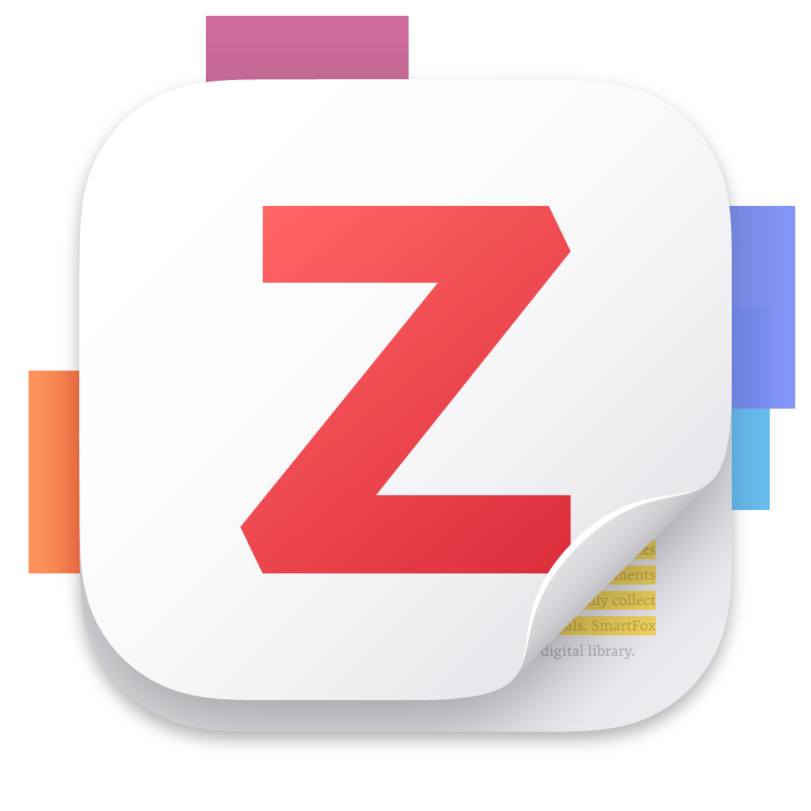

## Hi!

My name is Orville D. Hombrebueno. I am a Math teacher at the College of Teacher Education, Nueva Vizcaya State University. I am the lead organizer of the R user group of NVSU.

::::: {.columns}
::: {.column width="32%"}

{height="400px" fig-align="left"}

:::

::: {.column width="68%"}

-  [ellivromvvn](https://github.com/ellivromvvn)
-  [mildorville](https://fosstodon.org/@mildorville)
-  [odhombrebueno.bsky.social](https://bsky.app/profile/odhombrebueno.bsky.social)
-  [odhombrebueno](https://x.com/odhombrebueno)
-  [Orville Dulay Hombrebueno](https://www.facebook.com/orville.hombrebueno)

:::
:::::

## This talk is about...

- Reference management tools
- Editing tools
- Live demo

## What is a reference management tool?

A reference management tool (also called a citation manager or bibliographic software) is a computer application or software that helps students, researchers, and academics collect, store, organize, and format citations and reference lists [@referenc2026].

## Why use reference management tools?

Reference management tools help you collect, manage, cite, and share bibliographic references. These tools can be used to automatically generate both in-text citations and bibliographies, organize PDFs, and share references between team members [@woodward2026].

Reference management tools helps you:

- Save time
- Stay organized
- Easily save references from databases and the web
- Create citations automatically
- Quickly change citation styles

## Reference management tools

::: panel-tabset
## {height="40px"} Zotero

> [Your personal research assistant](https://www.zotero.org)

- **Cost:** Free
- **Word Processor Plugins:** Microsoft Word, LibreOffice, Google Docs, and a variety of other word processors and writing systems
- **Browser Extensions:** Chrome, Firefox, Safari, and Edge
- **Online Storage:** 300 MB for free
- **Local Storage:** Unlimited (limited only by your computer's hard drive)

## {height="40px"} Endnote

> [Building ideas, one citation at a time.](https://endnote.com)

- **Cost:** A free, limited, web-based version is available. Academic pricing on a full license is available through OneHub.
- **Word Processor Plugins:** Microsoft Word
- **Browser Extensions:** Chrome, Firefox, and Safari
- **Online Storage:** 2 GB with a free account, unlimited with a desktop account

## {height="40px"} Mendeley

> [The *free* all-in-one reference manager](https://www.mendeley.com)

- **Cost:** Free
- **Word Processor Plugins:** Microsoft Word and LibreOffice
- **Browser Extensions:** Chrome, Firefox, Internet Explorer, Safari, and other web browsers
- **Online Storage:** 2 GB for free, more storage options available for a fee

## {height="40px"} JabRef

> [Stay on top of your Literature](https://www.jabref.org)

- **Cost:** Free
- **Word Processor Plugins:** Microsoft Word, LibreOffice/OpenOffice and Latex
- **Browser Extensions:** Chrome, Firefox, Edge, Vivaldi
- **Local Storage:** Unlimited (limited only by your computer's hard drive)
:::

## What is a research editing tool?

A research editing tool is software designed to help students, academics, and writers improve the clarity, accuracy, and formatting of their scholarly work. These tools use artificial intelligence and rule-based checks to catch grammar errors, fix citation styles, and refine academic tone before a paper is submitted or published.

## References
